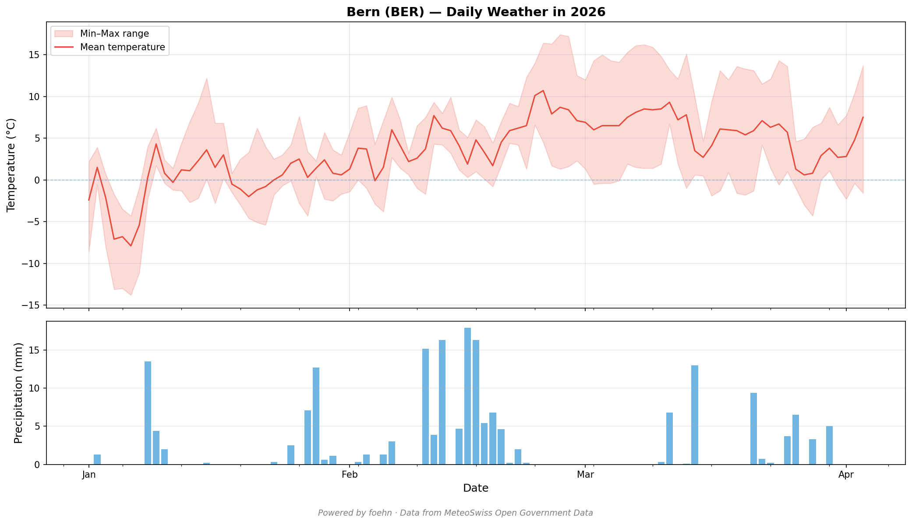

# MCP Server

foehn includes an [MCP server](https://modelcontextprotocol.io) that gives LLMs live access to MeteoSwiss data. It is published on the [MCP Registry](https://registry.modelcontextprotocol.io).

<p align="center">
  
</p>
<p align="center">
  <em>Daily weather in Bern, powered by foehn's MCP server and MeteoSwiss open data.</em>
</p>

---

## Installation

```bash
pip install "foehn[mcp]"
```

---

## Configuration

Add foehn to your MCP client config:

```json
{
  "mcpServers": {
    "foehn": {
      "command": "foehn",
      "args": ["mcp"]
    }
  }
}
```

Or, without installing anything first, let [uv](https://docs.astral.sh/uv/) fetch
it on demand — this is also what MCP Registry clients run:

```json
{
  "mcpServers": {
    "foehn": {
      "command": "uvx",
      "args": ["--with=foehn[mcp]", "foehn", "mcp"]
    }
  }
}
```

`foehn mcp --transport streamable-http` serves over HTTP instead of stdio.

---

## Available tools

| Tool | Description |
|---|---|
| `list_datasets` | Browse all MeteoSwiss datasets with metadata |
| `load_data` | Fetch weather measurements as rows |
| `describe_data` | Get summary statistics for a dataset |
| `aggregate_data` | Compute means, extremes, totals and counts per station, year, month, date or hour |
| `describe_grid` | Inspect a gridded dataset's dimensions and variables (NetCDF, GRIB2, radar) |
| `get_parameters` | Look up what each column measures |
| `get_stations` | Find station abbreviations and locations |
| `get_points` | Find local-forecast points by name, station or postal code |
| `get_inventory` | Check data availability per station |

`load_data` returns at most 500 rows, and `load_data` and `describe_data` may
each download at most 1 GB. MeteoSwiss publishes one file per station and time
slice, and the `year`, `month` and date filters trim rows only after a file is
downloaded, so a call's cost is set by `station`, `frequency` and `time_slice`.
A call over the budget is refused with an error naming them, so the model can
narrow it and try again, and the server never runs out of memory.

`aggregate_data` answers summary questions — "mean July temperature per year in
Bern", "the 10 hottest days at Zurich" — without sending the rows to the model.
It takes the same filters and download budget as `load_data`, reduces the rows
on the server with the chosen `stats` (mean, min, max, sum, median, std, count),
grouped by `station`, a time part (`year`, `month`, `date`, `hour`) or any column,
and returns one row per group, sortable by any result column (`order_by`, `sort`).

`load_data`, `aggregate_data`, `get_inventory` and `get_points` return one page at a time — at
most 500 rows, 50 by default for `load_data` and 100 for the other two — with
`total`, `has_more` and `next_offset`; pass `offset` to get the next page. A full
listing (about 19,500 inventory rows for `smn`, 5,800 forecast points) would
otherwise overflow a model's context window. `get_inventory` also filters by
`station` and `parameter`.

Every parameter's schema carries its description, and the fixed vocabularies
(`frequency`, `time_slice`, `sort`, `category`) and ranges (`month`, `limit`,
`offset`) are declared in it, so a client can check a call before sending it. A
parameter that takes a list of stations, columns, years or months also accepts a
single value.

`describe_grid` is the gridded counterpart to `describe_data`, covering every
gridded collection — NetCDF, GRIB2 forecasts, and HDF5/ODIM radar (GRIB2 and
radar need a single-file `match`). It caches the source file locally and refreshes
it when STAC reports a newer asset (download-then-lazy); it needs the `grids` extra (`pip install
"foehn[grids]"`). It returns structure only — grid *values* aren't streamed into
the LLM context, and writing Zarr stores isn't exposed over MCP (use the Python
API or `foehn to-zarr` CLI).

The files `describe_grid` downloads are cached in your user cache directory —
`~/Library/Caches/foehn` on macOS, `$XDG_CACHE_HOME/foehn` (else `~/.cache/foehn`)
on Linux, `%LOCALAPPDATA%\foehn\Cache` on Windows — not in the directory the
client happens to start the server in. Set `FOEHN_DATA_DIR` in the server's
`env` to put them somewhere else:

```json
{
  "mcpServers": {
    "foehn": {
      "command": "foehn",
      "args": ["mcp"],
      "env": {"FOEHN_DATA_DIR": "/path/to/foehn-data"}
    }
  }
}
```
